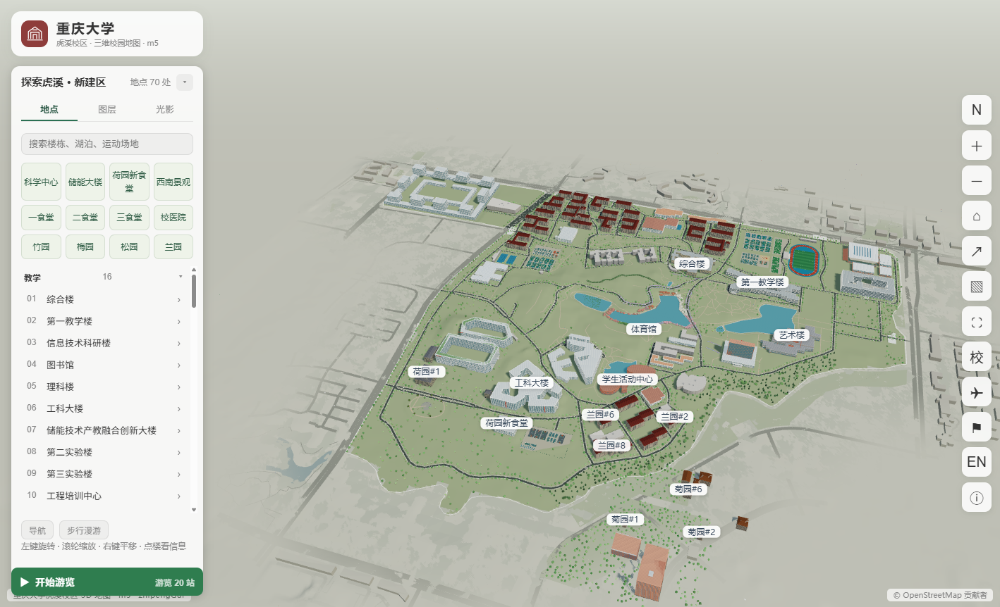
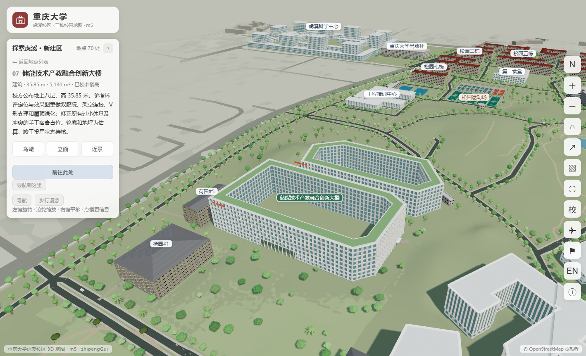
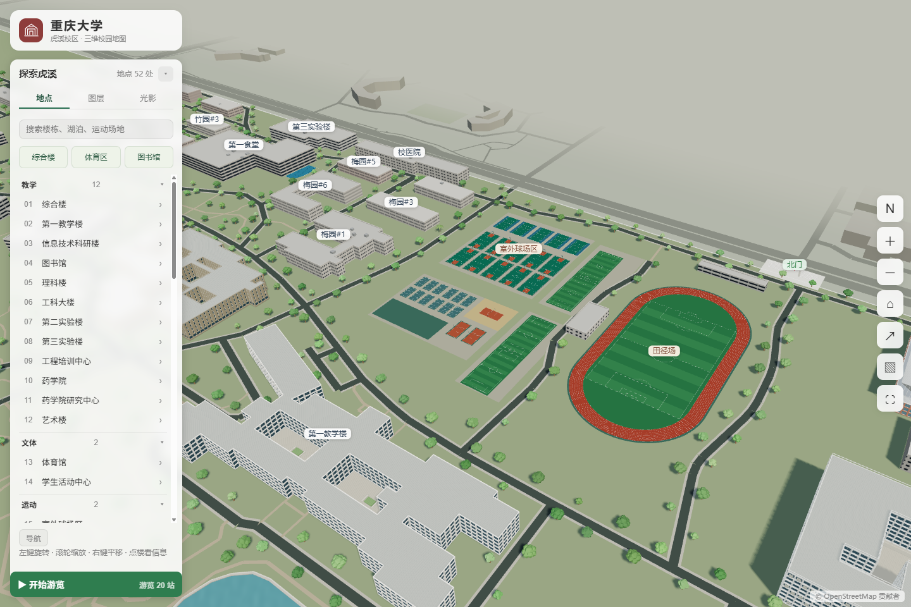
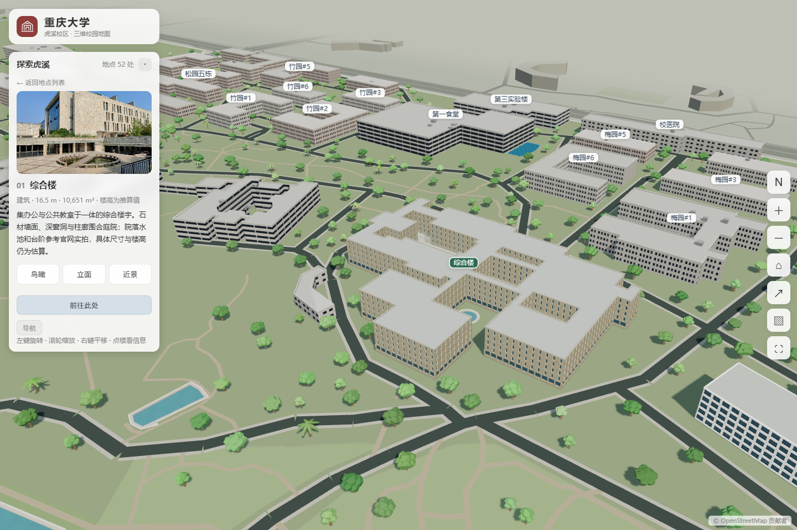

# 重庆大学 3D 校园地图

在浏览器中探索重庆大学虎溪校区与沙坪坝 A 区。地图支持旋转、缩放、地点搜索和交互导览，可通过电脑或手机访问。

当前展示版本为 **m5（2026-11-11）**，包含虎溪 m1–m5 的基础地形和分区精修成果，以及已上线的沙坪坝 A 区。版本号显示在地图左上角和浏览器标题中。

**[打开虎溪校区](https://zhipenggui.github.io/cqu-campus-3d/)** · **[打开沙坪坝 A 区](https://zhipenggui.github.io/cqu-campus-3d/?campus=shapingba)**

原创代码与模型 © 2026 ZhipengGui，保留所有权利。使用授权请通过 GitHub Issues 联系作者。第三方数据和解码器遵循下文所列许可。

[项目源码](https://github.com/zhipengGui/cqu-campus-3d) · [反馈问题与建议](https://github.com/zhipengGui/cqu-campus-3d/issues)



## 虎溪 m1–m5

| 版本 | 完成内容 |
| --- | --- |
| m1 | 全校基础地形；图书馆、综合楼、艺术楼、学生活动中心及周边地坪 |
| m2 | 第一教学楼、信息技术科研楼、理科楼和工科大楼的体量与细部 |
| m3 | 体育馆及附馆、田径场和梅园/松园/兰园运动场；修正活动中心白色楼翼误改 |
| m4 | 三处食堂、校医院、现有宿舍记录的窗洞、栏杆、门厅和道路接入 |
| m5 | 科学中心、储能大楼、荷园新食堂，西南部园路、休憩铺地、座椅与绿化 |

[科学中心](https://zhipenggui.github.io/cqu-campus-3d/?landmark=science) · [储能大楼](https://zhipenggui.github.io/cqu-campus-3d/?landmark=energy) · [荷园新食堂](https://zhipenggui.github.io/cqu-campus-3d/?landmark=he_canteen) · [西南部景观](https://zhipenggui.github.io/cqu-campus-3d/?landmark=southwest)



三处新地标的导航已接入本版暂估入口。荷园新食堂展示计划完成形态，校方报道计划于 2027 年投用；储能楼当前投用状态待核。具体位置、未见立面和局部地坪包含估算，详见[版本与资料说明](docs/HUXI_MILESTONES.md)。

## 探索沙坪坝 A 区

- 通过工具栏的「校」切换校区，或从上方直接打开 A 区。搜索主教学楼、第五教学楼、文字斋、民主湖、风雨操场或思群广场即可定位。
- A 区包含地形、风雨操场的下沉看台与舞台、思群广场的台阶和挡墙，以及学生九舍、三食堂至美视电影学院一带的地坪起伏。建筑细部和局部标高为估算。
- [打开沙坪坝 A、B、C 区平面地形总图](https://zhipenggui.github.io/cqu-campus-3d/?campus=shapingba&terrain=flat)。

## 探索虎溪

- **校园地标**：综合楼、第一教学楼、信息技术科研楼、图书馆、理科楼、体育馆、学生活动中心、艺术楼、工科大楼、科学中心与储能大楼，以及北门、东门和西门。
- **生活区与新建区**：三处既有食堂、校医院、宿舍片区和荷园新食堂完成形态预览；步道、入口及平台与展示地形衔接。
- **湖景与运动场地**：浏览缙湖、云湖及校园绿地，查看田径场、足球场、篮球场、网球场等运动区域。
- **地点搜索**：按名称搜索建筑、湖泊或运动场地，点击地图或地点列表查看介绍并定位。
- **多种观察视角**：重点建筑支持鸟瞰、立面和庭院近景，方便观察建筑布局与细节。
- **校园导览**：跟随精选巡游探索校园，也可以选择起终点查看步行路线。
- **桌面步行漫游**：从综合楼、一教、信息楼或图书馆附近进入，用鼠标观察、WASD 沿校园道路移动。
- **光影与分享**：切换清晨、日间、黄昏和夜间光影，调整图层与画质，分享当前视角或导出地图图片。

## 画面预览

| 体育区 | 综合楼 |
| --- | --- |
|  |  |

## 如何使用

| 操作 | 电脑 | 手机 |
| --- | --- | --- |
| 旋转视角 | 鼠标左键拖拽 | 单指拖动 |
| 缩放地图 | 鼠标滚轮 | 双指捏合 |
| 平移地图 | 鼠标右键拖拽 | 双指拖动 |
| 查看地点 | 点击建筑、标签或地点列表 | 点按建筑、标签或地点列表 |

侧栏首行提供科学中心、储能大楼、荷园新食堂和西南景观快捷入口，其他楼栋可从地点列表或搜索进入。工具栏中的主页按钮可返回校园全景；手机端点击右上角“···”可展开缩放、分享和图片导出等工具。

点击“路线导航”，选择起点和终点，也可用“地图选点”指定位置；支持交换两端点与从地点详情直接导航。科学中心、储能楼与荷园新食堂使用本版暂估入口，其他地点使用已配置的接近点或附近道路。

电脑端点击“步行漫游”，选择地点后点击开始，浏览器会锁定鼠标。使用 WASD 移动、鼠标转向，按住 Shift 加速，按 Esc 返回地图。默认速度3.5m/s，加速为8m/s。室外漫游沿展示地形调整高度，通行范围依据已映射的道路与铺装，建筑、水面和校界设有基础碰撞。

工具栏 ✈ 或按 V 进入自由视角飞行：WASD 移动、Space 上升、C 下降、Shift 加速、滚轮调节速度，建筑与地图范围设有碰撞边界（手机端用虚拟摇杆）。“开始游览”提供经典全线、植物花卉（联动春季）与建筑鉴赏三条主题路线；点击路上的行人或观光车可开启跟拍。工具栏 ⚑ 可在地图上标点发起纠错。首次访问会自动弹出功能导览，也可在“关于”中重新查看。

## 更新日志

- **m5（2026-11-11）**：发布虎溪 m1–m5 累积精修与地形，新增科学中心、储能楼和荷园新食堂直达入口；西南景观园路与休憩点接通；修正新建区与旧手工宿舍占位冲突，补齐新入口导航。保留沙坪坝 A 区详细地图及平面总图。

- **v12（2026-10-25）**：11 栋新精建地标（三食堂/海吉亚医院/实验楼/药学院等）；地标 GLB 流式加载（首屏零等待）；校园动态层（行人漫步、白色观光车与校车、五处人流热点）；步行导航引导（步行前往/偏航重算/到达提示）；主题游览线与电影运镜；自由视角飞行（桌面+手机摇杆）；行人/车辆/动画独立开关；新用户功能导览与地图纠错入口；许可证由 MIT 调整为保留所有权利。
- **v11（2026-10-24）**：观感升级（夜景窗灯/程序化天空/楼型色相/材质细节）；补入科学中心、海吉亚医院、荷园、菊园、储能大楼等新建筑与熙街周边；图书馆/综合楼/一教/科学中心精细建模；宿舍精修（坡顶/窗户/阳台）；中英双语；植物园绿化（行道树数据化、环湖七专类园、四季季相）。
- **v10（2026-10-17）**：导航系统（起终点路线/交换/详情直达导航/接近点）；桌面第一人称步行漫游（碰撞控制）；此前：巡游导览、光影预设、移动端适配。

## 本地运行

项目使用 **Three.js、TypeScript 和 Vite**，以静态网页形式运行。普通建筑与地表来自 OpenStreetMap 数据，重点地标采用 Blender 建模，并按观察距离加载不同精度的模型。

准备 Node.js 22 和 npm，在项目目录中执行：

```sh
npm ci
npm run dev
```

打开 [http://localhost:5188/](http://localhost:5188/) 即可预览。

构建生产版本：

```sh
npm run build
```

产物位于 `dist/`。部署到子目录时，通过环境变量 `BASE_PATH` 设置站点路径；本项目 GitHub Pages 使用 `/cqu-campus-3d/`。

## 发布范围

| 仓库与在线 Demo 包含 | 本地单独维护 |
| --- | --- |
| 前端代码、浏览器端建模与渲染模块、近/远景 GLB、场景和地形网格、道路与入口数据、预览截图 | Blender 工程、离线建模/导出工具、制作参数、原始参考照片与 PDF、原始 DEM 瓦片、内部核对表、备份、日志和缓存 |

线上体验使用完整运行资源。浏览器加载的 GLB、JSON 和 JavaScript 属于公开展示资源；原创代码与模型的使用仍须获得作者授权。仓库通过 `.gitignore` 排除本地制作目录、原始素材和构建产物。

推送到 `main` 后，GitHub Actions 自动安装依赖、构建并发布 GitHub Pages。`dist/` 由工作流生成，不直接提交。

## 关于地图

地图面向校园展示与探索，由现有地图轮廓、公开资料和参考照片共同构建。建筑细节、植被分布及部分场地尺寸包含示意或估算，欢迎通过 [Issues](https://github.com/zhipengGui/cqu-campus-3d/issues) 提供照片、位置校正和使用建议。

## 致谢与许可

- 项目的视觉表现与实现参考了 [gxu-campus-3d](https://github.com/wcqqq1214/gxu-campus-3d)。
- 地图数据 © [OpenStreetMap 贡献者](https://www.openstreetmap.org/copyright)，遵循 ODbL。
- 虎溪与 A 区详细场景使用裁剪、重采样并局部调整的 FABDEM V1-2，原始分辨率约 30 米，展示网格与局部平台为插值及估算。署名 Neal、Hawker、Uhe、Paulo、Sosa、Savage 和 Sampson（2023），University of Bristol。派生网格遵循 [CC BY-NC-SA 4.0](https://creativecommons.org/licenses/by-nc-sa/4.0/)。[FABDEM 数据集](https://doi.org/10.5523/bris.s5hqmjcdj8yo2ibzi9b4ew3sn)
- 早期基础地形及 FABDEM 上游数据涉及 [Copernicus DEM GLO-30 Public](https://registry.opendata.aws/copernicus-dem/)。Produced using Copernicus WorldDEM-30 © DLR e.V. 2010–2014 and © Airbus Defence and Space GmbH 2014–2018 provided under COPERNICUS by the European Union and ESA. All rights reserved.
- 参考照片来自重庆大学公开图集，照片权利属于原权利人。
- Draco 解码器采用 Apache License 2.0，详见 [public/draco](public/draco/)。
